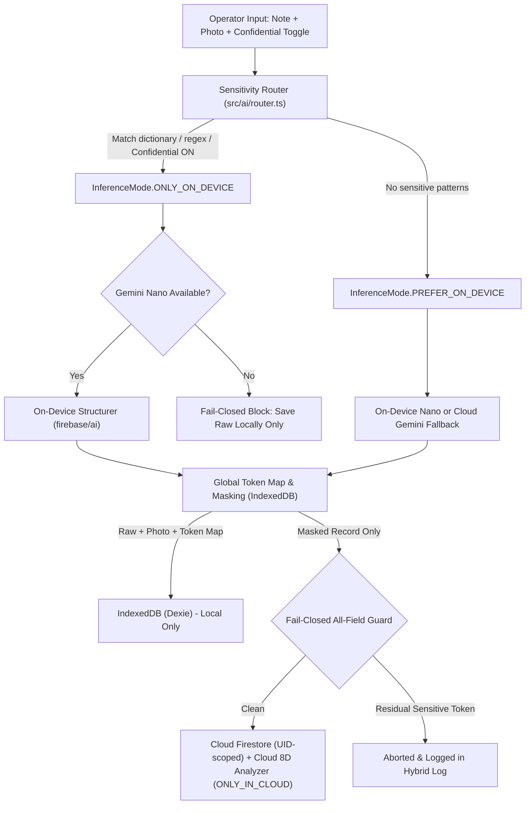

# LineNote — Factory Floor Defect Recording Hybrid AI Copilot

> **"Hybrid isn't a fallback trick here — it's a data-governance policy. The app decides per request where inference is allowed to run."**

Built during the **#BuildHybridAI 2026** submission period (Google · Firebase AI Logic).

---

## What It Is

LineNote is a local-first web application for quality control (QC) operators and supervisors in a fictional **sheet-metal enclosure manufacturing plant**.

- **Floor Operators** capture defect notes (with optional resized JPEG photos) using glove-friendly 48px+ controls. Sensitive details (customer names, drawing numbers, unit prices) are structured **strictly on-device** with Chrome Built-in Gemini Nano (`InferenceMode.ONLY_ON_DEVICE`).
- **Quality Supervisors** select multiple de-identified (masked) records and run **Cloud Gemini** (`InferenceMode.ONLY_IN_CLOUD`) to generate a Pareto breakdown, top-3 root-cause hypotheses, and a full 8D report draft (D1–D8), then optionally restore masked tokens locally on screen.

---

## Hybrid Routing Policy

| Task | `InferenceMode` | When On-Device Gemini Nano Is Unavailable |
| :--- | :--- | :--- |
| Confidential defect structuring | `ONLY_ON_DEVICE` | Blocked from cloud (**fail-closed**); raw note saved locally without AI |
| Standard defect structuring | `PREFER_ON_DEVICE` | Automatically falls back to Cloud Gemini |
| Multi-record Pareto & 8D analysis | `ONLY_IN_CLOUD` (masked only) | Queued offline via Firestore `persistentLocalCache` |
| Short KO ↔ EN note translation | `PREFER_ON_DEVICE` | Automatically falls back to Cloud Gemini |

---

## Privacy & Data-Governance Design

1. **Sensitivity Router (`src/ai/router.ts`)**: Pre-scans notes with Remote Config regex patterns and customer dictionaries. Matches or the user's Confidential Lock force `InferenceMode.ONLY_ON_DEVICE`.
2. **Global Token Map (`src/ai/masking.ts`, `src/data/db.ts`)**: Deterministic `{start, end, kind}` span resolution (`CUSTOMER` dictionary > regex > model) maps the same sensitive entity to the same token across all records on the device (`ACME-77` → `[CUSTOMER_1]`, `EN-2231` → `[DRAWING_1]`). The token map is stored **only in IndexedDB (Dexie)** and never leaves the device.
3. **Fail-Closed Cloud Guard (`sanitizeAndGuardCloudRecord`)**: Before any Cloud AI or Firestore call, all string fields (`maskedNote`, `part`, `location`, `suspectedCause`, `immediateAction`, `line`) are scanned and sanitized. Any residual sensitive pattern aborts the request and logs `blocked: true` in `/hybrid-log`.
4. **Local-Only Restoration (`src/pages/Analyze.tsx`)**: Restored values default to **OFF**. When toggled ON, restored tokens are highlighted with a dotted underline and labeled `"Restored locally on this device - cloud saw only tokens"`. Export 8D (`.md`) exports masked tokens by default, with an explicit `"Export with local values"` option.

---

## Architecture



---

## Setup & Local Development

### 1. Install Dependencies
```bash
npm install
```

### 2. Configure Firebase & App Check
1. Create a Firebase project and enable **Firebase AI Logic** (Gemini Developer API), **Authentication** (Anonymous), **Cloud Firestore**, **Remote Config**, and **App Check** (**reCAPTCHA Enterprise**).
2. Copy `.env.example` to `.env.local` and fill in your Firebase web config and `VITE_RECAPTCHA_ENTERPRISE_SITE_KEY`:
   ```bash
   cp .env.example .env.local
   ```
   *(Never commit `.env.local` or any debug token.)*

### 3. Enable Chrome On-Device Gemini Nano (Chrome Desktop 139+)
1. Open `chrome://flags/#prompt-api-for-gemini-nano-multimodal-input` → **Enabled**
2. Open `chrome://flags/#optimization-guide-on-device-model` → **Enabled BypassPerfRequirement**
3. Relaunch Chrome, open `/device-check`, and click **Run Hello Test** to initialize and verify on-device inference.

### 4. Run Locally & Execute Tests
```bash
npm run dev
npx vitest run
npm run build
```

### 5. Deploy to Firebase Hosting
```bash
firebase login
firebase deploy --only firestore:rules,hosting
```

---

## Measured Latencies

| Operation | Inference Source | Measured Time | Notes |
| :--- | :--- | :--- | :--- |
| Confidential note structuring | `on_device` (Gemini Nano) | _TBD (user Chrome)_ | Includes deterministic quantity post-processing |
| Multi-record Pareto & 8D (12 records) | `in_cloud` (`gemini-3.5-flash-lite`) | _TBD (user Chrome)_ | Masked tokens only |
| Standard note fallback (no Nano) | `in_cloud` | _TBD (user Chrome)_ | Automatic fallback for non-sensitive notes |

---

## License

Apache-2.0 — see [LICENSE](./LICENSE).
